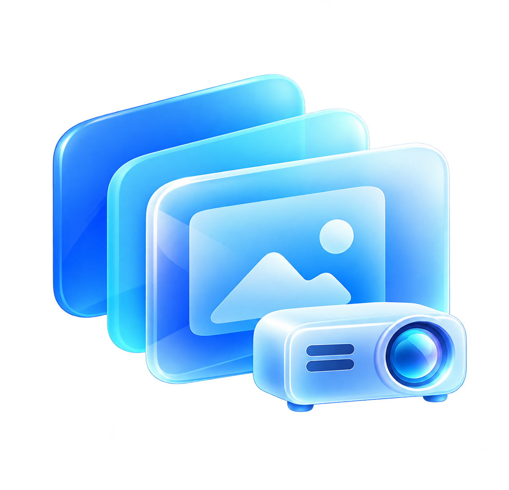
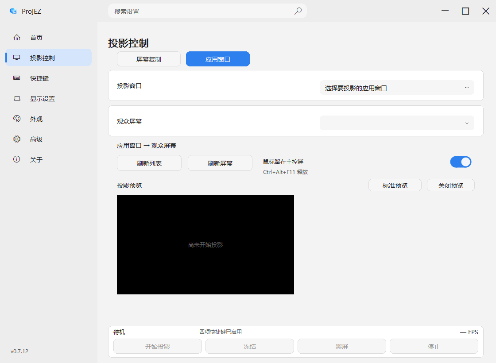

<div align="center">

<h1>ProjEZ</h1>
<p><strong>Keep the audience's picture steady while you keep working.</strong></p>
<p>Windows projection controls · Screen mirroring · Window capture · Freeze and black screen</p>
<p><a href="README.md">中文</a> · <a href="https://github.com/wangmk23/ProjEZ/releases">Downloads</a> · <a href="docs/BUILD.md">Build instructions</a> · <a href="CHANGELOG.md">Changelog</a></p>
</div>

> **AI development disclosure:** This product was developed by AI, with its features and improvements guided by user requirements, testing, and feedback.

ProjEZ mirrors your primary display or captures one application onto an extended display. Freeze the audience's frame while using other software on your control display, then resume. A black-screen action temporarily hides the output. On supported Windows 10 2004+ / Windows 11 systems, full-screen mirroring can exclude the ProjEZ control window from capture while keeping it visible on your primary display, and the window can optionally close to the system tray.



## Quick start

Windows 10 1903+ or Windows 11, x64. Connect a second display and select **Win + P → Extend**. Download and extract a portable package from Releases, or build the source before the first public release. Launch ProjEZ and choose primary-screen mirroring or an application window.

| Action | Default shortcut |
| --- | --- |
| Freeze | Ctrl + Alt + F8 |
| Resume | Ctrl + Alt + F9 |
| Black screen | Ctrl + Alt + F10 |
| Stop output | Ctrl + Alt + F12 |
| Release cursor | Ctrl + Alt + F11 |

Record new combinations in the shortcut settings. Press Esc to cancel. Close older instances to avoid registration conflicts. Stopping output reveals the extended Windows desktop; use black screen for temporary hiding.

## Limitations

Actual performance depends on hardware and drivers. Screen capture can fall back to GDI; failed window capture does not switch to full-desktop capture. Preview is a thumbnail of submitted frames, not a physical-display feed. Lower-resolution output cannot preserve every source detail. Auxiliary privacy protection cannot guarantee that all notifications are hidden. The executable is unsigned.

User configuration is stored locally. Review [privacy notes](docs/PRIVACY.md) before sharing screenshots or diagnostics. The current application UI is Chinese.

## Development

```powershell
go test ./... -count=1
go vet ./...
pwsh -File scripts/build.ps1
```

See [BUILD.md](docs/BUILD.md), [CONTRIBUTING.md](CONTRIBUTING.md), and [CHANGELOG.md](CHANGELOG.md). MIT licensed.

In the 0.8.0 preview, use the projection picker to click a window, drag a screen region, or select the entire screen. The layer editor adds PNG/JPEG images and styled text. Edit sources and layers before starting projection.
